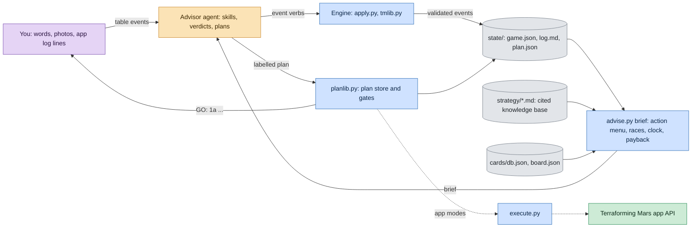

<h1 align="center">🪐 MarsMind</h1>

<p align="center"><b>An AI advisor that sits at your Terraforming Mars table and plays to win.</b></p>

<p align="center">
  <a href="https://github.com/georgecristea/marsmind/actions/workflows/tests.yml"></a>
  
  
  
  <a href="LICENSE"></a>
</p>

You play the board game. A coding agent (Claude Code or Codex) runs inside this
repository as your advisor. It keeps the **exact** game state through
deterministic Python, prices every option against a cited strategy knowledge
base, and tells you the winning line every generation: at a real table from
phone photos and what you tell it, in the online app, or against LLM opponents
it spins up itself.

> **The code computes. The model judges.** The model never does arithmetic and
> never states a game value from memory. Scripts own state, legality and maths;
> gates stop the model when it is about to make a known mistake; the model makes
> the strategic call.

---

## Why it's interesting

If you build with LLM agents, this is a worked example of an agent doing a hard,
long-horizon task with real stakes. Each of these was learned from a lost game.

- **A hard split between judgment and arithmetic.** About 23k lines of
  standard-library Python own every number: card costs and discounts,
  production, terraform rating, tile adjacency, the legal action menu,
  milestone and award races, the end-of-game clock. Before every
  recommendation the agent reads a fresh brief from `scripts/advise.py`; it
  never answers from memory.
- **Gates that interrupt the model.** The scripts refuse to pass while a free
  or profitable action is still on the menu, refuse to fund an award that isn't
  locked up, and refuse a plan with no threat analysis. Overriding a gate needs
  a written reason, and every override is audited after the game as
  *helped / hurt / wash*.
- **LLM opponents behind an information firewall.** In practice games the
  advisor faces model-piloted seats. Each seat is a separate subagent that only
  ever sees its own player id, and the game server enforces hidden hands.
- **A blind model-vs-model match.** Claude (Opus 5) and Codex (GPT-5.6) each
  played one seat of the same online game through this harness, and neither
  was told its opponent was an AI. Both wrote their post-mortems before
  learning the truth. Read them side by side:
  [`experiments/2026-08-29-distant-neutron-surge/`](experiments/2026-08-29-distant-neutron-surge/).
- **Files are truth, sessions are disposable.** Every event lands in
  `game.json` and an append-only log. If the laptop dies mid-game, a new session
  resumes from disk. By design the agent also clears its context at every
  generation, so a long game never drags a growing transcript.
- **It learns from its losses.** After each game a narrator agent writes the
  story and a knowledge-base agent folds the lessons into `strategy/`. Rules
  carry evidence tags and are promoted or demoted as later games confirm or
  refute them; guard tests reject a sloppy fold.
- **2,400+ tests,** including replays of recorded app logs checked against the
  app's own final scores. CI runs on every push.

## What a turn looks like

Every reply starts with the one instruction to execute (`GO:`, `PICK:`, `BUY:`),
then the reasoning, then the mechanics. Each action is an **execution trace**
from the engine, never from the model's head:

```
Zed played Sponsors (paid 6 MC) → balance 40 MC
  1. paid 6 MC (base 6)
  2. MC production 0 → 2
```

Every reply ends with the **plan block**. The plan store renders it, and the
model pastes it verbatim. Steps are labelled, so you just report back
"did 1a":

```
Plan — generation 1
⚠ THREATS
  - Anna is 1 city from Mayor (2 of 3) — claim race; Felix leads Banker by 4 MC production
🎯 EXIT: greeneries + Ecoline 7-plant conversions; repeatable: 1 greenery per generation from plant production
✅ 1a  🔒 Play Sponsors — +2 MC production, cash engine
▶️ NEXT 1b  🔁 Convert 7 plants → greenery next to own city
⬜ 2a  🔒 Pass — nothing left above break-even
```

🔒 = safe to execute blind · 🔁 = re-check the board first. Tile placements come
as a rendered map with the target hex ringed. (Both samples above are real tool
output.)

## How it works



🟠 the model's judgment · 🔵 deterministic Python · ⬜ files that are truth ·
🟣 people · 🟢 the app over HTTP. The full picture, mode by mode, is in
[docs/harness.md](docs/harness.md).

## Three ways to play

| Mode | Opponents | What the agent sees | Ground truth |
|---|---|---|---|
| **physical** | real people at a real table | your words and phone photos | photos of mats and the board |
| **app-online** | real people in the online app | pasted log lines and screenshots, or the app's API (opt-in) | the app |
| **app-practice** | LLM-piloted seats on a local copy of the app | the API, through a firewall per seat | the app |

Details: [docs/modes.md](docs/modes.md).

## Quick start

Requirements: Python 3.10+ (standard library only, nothing to `pip install`)
and a coding agent that reads `AGENTS.md`: [Claude Code](https://claude.com/claude-code),
Codex or similar. Node 22 only if you want the local practice app.

```
git clone https://github.com/georgecristea/marsmind && cd marsmind
python3 scripts/doctor.py        # checklist: Python, data files, folders
```

Then start your agent in the folder (`claude` or `codex`) and talk to it:

- *"New game: physical table, me red, Anna green, Ben yellow, base + Corporate Era."*
  It runs `scripts/setup.py` and helps you choose a corporation and opening hand.
- Each generation, send a photo of the four research cards. It answers
  `PICK:` before anything else.
- Tell it what happens at the table in plain words (*"Anna played Comet on
  me"*) and ask *"what do I do?"*.
- At the end: final scoring, a written story of the game, and the lessons
  folded back into the knowledge base.

### Practice against AI opponents

```
scripts/vendor_bootstrap.sh --build      # fetch + build the open-source game engine at the pinned commit
python3 scripts/server.py                # start the local app (prints local + LAN URLs)
python3 scripts/newgame.py --players "You=red,Anna=green,Ben=yellow"   # prints player ids
```

Then tell the agent which seat is yours. It dispatches one firewalled subagent
per opponent seat ([agents/sparring-partner.md](agents/sparring-partner.md)).
Opponent strength runs from scripted bots to full LLM seats; see the
[adversary ladder](docs/bots.md). You can also invite an external agent on
another machine to play a seat: [docs/versus.md](docs/versus.md).

## Results so far

From the project's results ledger (base game + Corporate Era, Tharsis map):

| Opponents | Games | Record |
|---|---:|---|
| LLM-piloted seats (Claude Haiku, Sonnet, Opus; 2–5 players) | 13 | **8 W – 5 L** |
| Human players, online app (4–5 players) | 2 | **1 W – 1 L** |

These are small samples with uncontrolled card draws, and seat strength varies
with model and doctrine version. Wins against scripted dummy bots aren't
counted. The blind Claude-vs-Codex game isn't in the table either, because the
harness was on both sides. The evaluation protocol is in
[docs/bots.md](docs/bots.md).

## Repository layout

| Path | What lives there |
|---|---|
| `AGENTS.md` | The agent's contract: iron rules, routing, output format. Read first by every host. |
| `skills/` | Procedures used during play: setup, research phase, turn advisor, event logging, reconciliation, threat analysis, output format |
| `agents/` | Briefs for offline subagents: narrator, knowledge-base researcher, vision extractor, opponent seats |
| `scripts/` | The state engine (`tmlib.py`), event CLI (`apply.py`), plan store, executor, calculators |
| `strategy/` | The strategy knowledge base: valuation, archetypes, corporations, card tiers, openings, lessons from play |
| `cards/`, `board.json` | Card database and Tharsis map, extracted from the open-source engine |
| `tests/` | Unit tests and replay fixtures (`python3 scripts/test.py`) |
| `experiments/` | Write-ups of controlled runs, starting with the blind model-vs-model match |
| `docs/` | [harness in diagrams](docs/harness.md) · [architecture](docs/architecture.md) · [modes](docs/modes.md) · [setup](docs/setup.md) · [action space](docs/actions.md) · [agent hosts](docs/hosts.md) · [command playbook](docs/PLAYBOOK.md) · [roadmap](docs/ROADMAP.md) |

Internally the engine is codenamed **PHOBOS** (after Mars's inner moon), which
is why environment variables look like `PHOBOS_APP_URL`.

## How it was built

Test-first, mostly by AI coding agents (Claude Code, with some Codex) working
under the author's direction. The agents follow the same kind of contract the
advisor follows at the table: every change to `scripts/` starts with a failing
test, and bugs found during play are filed, never hot-fixed mid-game. See
[CONTRIBUTING.md](CONTRIBUTING.md).

## Fair play

Tell your opponents an AI advisor is in use. Some tables and online communities
don't allow it.

## Acknowledgments and license

Terraforming Mars is designed by Jacob Fryxelius and published by FryxGames.
This is an unaffiliated fan project with no game artwork and no rulebook text.
The open-source [terraforming-mars](https://github.com/terraforming-mars/terraforming-mars)
engine isn't bundled; `scripts/vendor_bootstrap.sh` fetches it on demand.
`cards/db.json` and `board.json` are derived from it, which is why this project
is GPL-3.0 too. The strategy knowledge base paraphrases public community
analysis and credits its sources in [`NOTICE`](NOTICE).

Licensed under [GPL-3.0](LICENSE).
