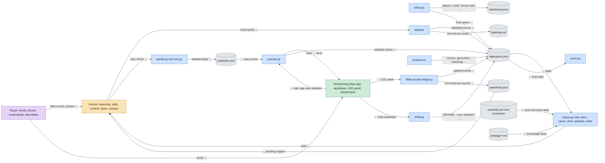
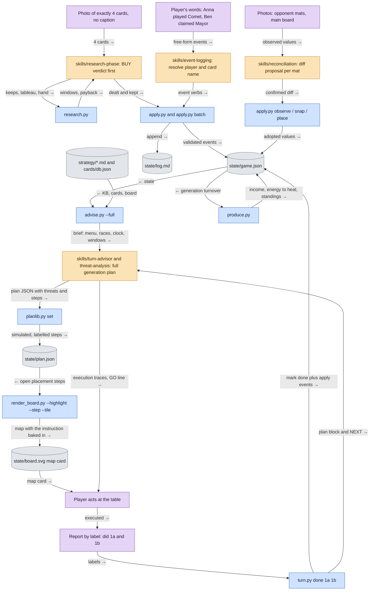
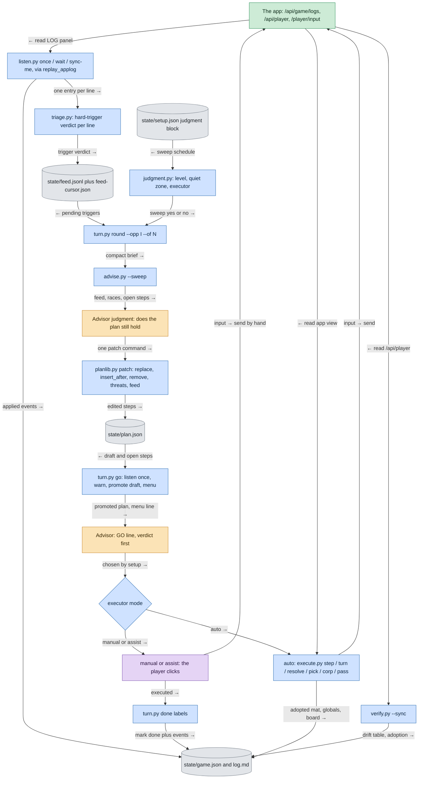
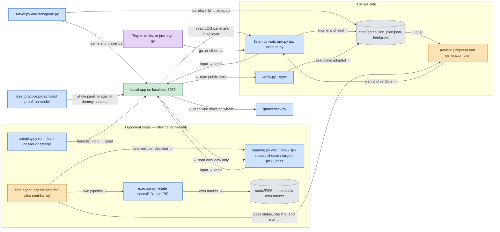
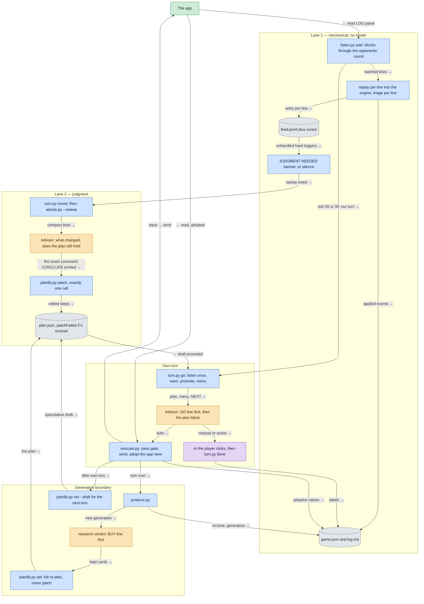

# The harness, in pictures

MarsMind is a table advisor for Terraforming Mars: the human plays the game,
the harness keeps the state exact and recommends the winning line. This
page is the visual map of how that works — the pieces, the files, and the
loop each game mode runs.

## How to read these diagrams

Everything in the harness is one of five things, and every diagram uses the
same five colours for them:

| Colour | Class | What it is |
|---|---|---|
| 🟠 amber | `reasoning` | The model's judgment — verdicts, generation plans, judgment sweeps, research picks, threat blocks. Nothing here is deterministic. |
| 🔵 blue | `script` | Deterministic Python in `scripts/` — the engine, the plan store, the executor, the calculators. Same input, same output, every time. |
| 🟢 green | `api` | Talking to the Terraforming Mars app over HTTP. Edge labels say the direction: `→ send` writes an input, `← read` pulls a view or the LOG panel. |
| 🟣 purple | `human` | Input from people — photos, screenshots, pasted LOG lines, spoken table events, the player clicking in the app. |
| ⬜ grey (cylinder) | `state` | Files that are truth. `state/setup.json`, `game.json`, `plan.json`, `log.md`, `feed.jsonl`, `cards/db.json`, `board.json`, `strategy/*.md`. Sessions are disposable; these files are not. |

Two rules explain most of the wiring. **Files are truth** — a session can
die at any moment and a new one resumes from `state/`. And **the split of
labour is strict**: arithmetic, legality and state changes belong to blue
(never to the model's memory), while evaluation, wording and the plan
belong to amber (never to a script). Every edge is labelled with what
flows along it and in which direction.

Three game modes share that machinery and differ only in the input
channels and in what counts as ground truth: **physical** (a real table),
**app-online** (the app against people, with or without its API) and
**app-practice** (the local app against AI seats). `state/setup.json`
carries the `gameMode` and every script obeys it.

---

## 1. Overview — the pieces and the flows

The player is the only actor at the table; the advisor never touches the
app or the game state directly. Input arrives as words, photos or app log
lines, and is turned into validated events by `apply.py` (or by
`listen.py`, when the API is on). Those events land in `state/game.json`
and `state/log.md`. To recommend anything, the advisor runs `advise.py`,
which re-reads state, the card and board data and the strategy knowledge
base into one brief — the advisor never answers from memory. Its judgment
comes back out as a labelled plan through `planlib.py` into
`state/plan.json`, and is then executed either by the player's hands or,
in app modes, by `execute.py`. `produce.py` closes each generation at the
physical table; in app modes the listener owns that boundary (it adopts
"Generation N" from the app log and runs production once, and `produce.py`
refuses unless forced). `verify.py` reconciles the tracker against the app,
and `score.py` ranks everyone at the end.

**LEGEND** — 🟠 reasoning: the advisor. 🔵 script: `scripts/*.py`.
🟢 api: the app over HTTP (app modes only). 🟣 human: the player.
⬜ state: files that are truth.

---

## 2. Mode `physical` — one round at a real table

At a real table there is no API at all — it is forbidden in this mode.
Everything arrives as the player's words or as a phone photo, and every
phrasing routes to `skills/event-logging`, which turns it into `apply.py`
verbs immediately (one batched call, one line of acknowledgement). A photo
of exactly four cards is a research phase and triggers itself: the verdict
line comes first, the `research.py` plumbing check and the `dealt` log come
after it in the same reply. The generation plan comes from `advise.py`
(`--full` in physical mode, so the whole knowledge base is in every call)
and is stored as labelled steps by `planlib.py`; any step that places a
tile is delivered as a rendered map card, because a bare hex id is not
executable from a phone. The player then acts, reports by label, and
`turn.py done` marks the steps, applies their events and prints the next
one. Opponent mats and the main board are optional ground truth: whenever
a photo arrives, `skills/reconciliation` diffs it and `apply.py
observe/snap/place` adopts it.

**LEGEND** — 🟠 reasoning: skills the advisor runs. 🔵 script: deterministic
Python. 🟣 human: photos, words, hands at the table. ⬜ state: files.
🟢 api: **absent by design** — the app API is forbidden in `physical` mode.

---

## 3a. Mode `app-online`, API off — screenshots and the pasted LOG panel

Without the API the app is a screen the harness cannot see. The opponent
channel is the app's own LOG panel, pasted as text, plus screenshots of the
hand and the research row. Those go through the same `skills/event-logging`
grammar as spoken table events and land as `apply.py batch` events — the
advisor reads the lines, the script writes the state. The plan is composed
exactly as in physical mode; the player clicks it in the app and reports
the labels back. Reconciliation is by screenshot rather than photo, and it
is cleaner: printed numbers, no cube-colour guessing.

```mermaid
flowchart LR
  classDef reasoning fill:#fbe3b6,stroke:#c9862a,color:#3a2600
  classDef script fill:#cfe2ff,stroke:#2f6fb5,color:#0b2545
  classDef api fill:#cdebd6,stroke:#2f8f5b,color:#0d2b1a
  classDef human fill:#e5d4f5,stroke:#7a4fae,color:#2a1440
  classDef state fill:#e2e5e9,stroke:#78808a,color:#1e2328

  APP["The app in the player's browser"]:::api
  LOGP["Lines pasted from the LOG panel"]:::human
  SS["Screenshots: hand, research row, panels"]:::human
  CLICK["Player clicks the plan in the app"]:::human
  REPORT["Report by label"]:::human

  EVL["skills/event-logging plus reconciliation"]:::reasoning
  TA["skills/turn-advisor: plan and verdicts"]:::reasoning

  APPLY["apply.py batch"]:::script
  ADVISE["advise.py --brief"]:::script
  PLAN["planlib.py set"]:::script
  TURN["turn.py done"]:::script
  PROD["produce.py"]:::script

  GJ[("state/game.json and log.md")]:::state
  PJ[("state/plan.json")]:::state

  APP -->|"← read by eye"| LOGP
  APP -->|"← read by eye"| SS
  LOGP -->|"opponent events →"| EVL
  SS -->|"observed values →"| EVL
  EVL -->|"JSON-lines events →"| APPLY
  APPLY -->|"validated events →"| GJ
  GJ -->|"← state"| ADVISE
  ADVISE -->|"brief →"| TA
  TA -->|"plan JSON →"| PLAN
  PLAN -->|"labelled steps →"| PJ
  PJ -->|"← plan block, GO line"| TA
  TA -->|"exact UI verbs and button-label cues →"| CLICK
  CLICK -->|"input → send by hand"| APP
  CLICK -->|"executed →"| REPORT
  REPORT -->|"labels →"| TURN
  TURN -->|"mark done plus events →"| GJ
  GJ -->|"← turnover"| PROD
  PROD -->|"income and generation →"| GJ
```

**LEGEND** — 🟠 reasoning · 🔵 script · 🟢 api (the app, read only by the
player's eyes here) · 🟣 human · ⬜ state.

## 3b. Mode `app-online`, API on — the harness reads and can send

With the API opted in at setup (`appUrl` plus the player's own `playerId`),
`/api/player` fills the slot a mat photo would fill and the harness never
asks for one. `listen.py` is the mechanical lane: it pulls the LOG panel,
renders each entry to the export grammar, applies it into the live engine
through the replay machinery, appends one `triage.py` entry per line to
`state/feed.jsonl`, and keeps a cursor so nothing is applied twice. Its
exit codes carry the round: 20 or 30 means it is our turn. Judgment is the
other lane: `turn.py round` after opponent turns, `advise.py --sweep` when
`judgment.py` says a sweep is due, and exactly one `planlib.py patch` to
conclude it. On the player's own turn `turn.py go` promotes the draft and
prints the executor hint; who actually clicks depends on
`judgment.py set executor` — `manual` and `assist` leave it to the player,
`auto` lets `execute.py` send the input and then adopt the app's own view
back into the tracker. In app modes the app is the rules engine, so
adoption always beats simulation; `verify.py --sync` is the audited catch-up.

**LEGEND** — 🟠 reasoning: the judgment lane. 🔵 script: the mechanical
lane and the executor. 🟢 api: every arrow to or from the app, direction on
the label. 🟣 human: the player still clicks in `manual` and `assist`.
⬜ state: the feed, the tracker and the plan.

---

## 4. Mode `app-practice` — the local app and AI opponent seats

The training rig. `server.py` launches the vendored app (LAN-visible),
`newgame.py` creates the game and prints one `playerId` per seat, and
`setup.py` records our own seat. Opponents are either dummies
(`autoplay.py --level passer|greedy`, for harness testing only) or
competitive seats: one generic `seat` agent per opponent, dispatched with
its persona, `playerId` and model, following `agents/seat-kit.md`. The
information firewall is structural rather than promised — a seat acts only
through `sparring.py` with its own id, and if it runs the advisor's own
API-play verbs it does so against `seats/<pid>/`, created by
`session.py seat-init`. It never opens `state/` or `games/`, and never
queries another player's id; its report is pass status, one line and its
end mat, while its actual plays are read from the public API by
`verify.py --sync`. A seat is done only at GAME ENDED or SCOPE END —
a seat that stops early freezes the whole table, which is what
`gamecheck.py` exists to make visible.

**LEGEND** — 🟠 reasoning: the advisor and each seat agent (separate
minds, separate context). 🔵 script: the drivers and watchers. 🟢 api: the
local app. 🟣 human: barely involved in this mode. ⬜ state: the advisor's
tracker and each seat's own folder — the firewall is that no arrow crosses
between them.

---

## 5. The two-lane round loop

This is the loop that makes API play fast enough for a real round. Lane 1
is mechanical and blocking: `listen.py wait` sleeps through all the
opponents' turns and returns their events as one batch, so the advisor is
woken once per round rather than once per event. Lane 2 is judgment, and
it is deliberately event-driven: the listener itself decides when a look is
owed and ends a drain with a `JUDGMENT NEEDED` banner naming the unhandled
hard triggers. No banner means a quiet round and nothing to reason about.
A sweep concludes in exactly one `planlib.py patch` — a patch that errors
is stamped `patchFailed` and blocks execution until it lands. On the
player's own turn `turn.py go` warns about unhandled triggers rather than
refusing (the loop must never deadlock), promotes the draft, and hands
over to the executor; the pass gate refuses to transmit a pass while the
derived menu still lists an available action. At the generation boundary
the loop resets completely: the turnover (`produce.py` at the table; the
listener's "Generation N" adoption in app modes — applying it twice is a
no-op by design), then the research verdict, then a full re-plan — never a
patch — and immediately a fresh draft for the next turn, composed while
nobody is waiting.

**LEGEND** — 🟠 reasoning: only two boxes in the whole round — the sweep
verdict and the GO line. 🔵 script: everything else in the loop. 🟢 api:
the app. 🟣 human: the player, when the executor is not `auto`. ⬜ state:
the feed, the tracker, the plan.

---

## 6. Game end — scoring, the ledger, the story, and the regression proof

Scoring is deterministic and honest about what it cannot count: formula-VP
cards and unplaced cities are flagged for a manual count rather than
guessed, and `--abort` prints what the skipped milestones and awards would
have been worth so an omission cannot silently invert the standings. In
app modes `score.py --app` reads the app's own `victoryPointsBreakdown`
instead. `session.py end` closes the session and archives the folder;
`evalprotocol.py record` appends the result to the private ledger, keeping
opponent tiers apart so a win over dummy bots is never aggregated with a
win over competitive seats. Then the offline agents: `narrate.py` assembles
the facts and `agents/narrator.md` writes the shareable saga plus its
technical companion, while `agents/kb-researcher.md` folds the advisor's
own mistakes back into `strategy/*.md`. `replay_gate.py` is the proof that
none of this rots — it replays real recorded games through today's scripts
and fails if the board or TR no longer reproduce.

```mermaid
flowchart LR
  classDef reasoning fill:#fbe3b6,stroke:#c9862a,color:#3a2600
  classDef script fill:#cfe2ff,stroke:#2f6fb5,color:#0b2545
  classDef api fill:#cdebd6,stroke:#2f8f5b,color:#0d2b1a
  classDef human fill:#e5d4f5,stroke:#7a4fae,color:#2a1440
  classDef state fill:#e2e5e9,stroke:#78808a,color:#1e2328

  GJ[("state/game.json and log.md")]:::state
  APP["The app at phase end"]:::api
  SCORE["score.py, --abort or --app"]:::script
  STAND["Advisor: final standings message"]:::reasoning
  SESS["session.py end --note"]:::script
  ARCH[("games/DATE-gameN/ archived")]:::state
  EVAL["evalprotocol.py record and report"]:::script
  LEDGER[("private/evals.jsonl")]:::state
  ASK["Player: yes, write the saga"]:::human
  NARR["narrate.py: assemble the bundle"]:::script
  NAG["agents/narrator.md"]:::reasoning
  SAGA[("saga.md and insights.md")]:::state
  KBR["agents/kb-researcher.md"]:::reasoning
  KB[("strategy/*.md")]:::state
  GATE["replay_gate.py --all"]:::script
  FIX[("recorded logs plus the app's final state")]:::state
  TESTS["unittest discover -s tests"]:::script

  GJ -->|"← tracked state"| SCORE
  APP -->|"← read victoryPointsBreakdown"| SCORE
  SCORE -->|"ranking plus what is not countable →"| STAND
  STAND -->|"winner and score →"| SESS
  SESS -->|"link removed, folder closed →"| ARCH
  SESS -->|"result →"| EVAL
  EVAL -->|"one row per game, tier kept apart →"| LEDGER
  STAND -->|"offer the narrator →"| ASK
  ASK -->|"yes →"| NARR
  ARCH -->|"← log, game, setup"| NARR
  NARR -->|"facts bundle →"| NAG
  NAG -->|"story and numbers →"| SAGA
  ARCH -->|"← advisor mistakes from the log"| KBR
  KBR -->|"distilled principles →"| KB
  FIX -->|"← replayed from scratch"| GATE
  ARCH -->|"← every recorded game"| GATE
  GATE -->|"board and TR must match exactly →"| TESTS
```

**LEGEND** — 🟠 reasoning: the standings message and the two offline
agents. 🔵 script: scoring, ledger, assembly, regression. 🟢 api: the app's
own final table in app modes. 🟣 human: the player's yes. ⬜ state: the
archive, the ledger, the knowledge base, the fixtures.

---

## Script index

**The engine and state**
- `tmlib.py` — the core library: `Store` (load/save `game.json`, append-only `log.md`), `Engine` (one method per event type, with rule enforcement), `GameManager`.
- `apply.py` — the command-line face of the engine: 30 event verbs, each printing its trace and any `→ TABLE` step; `batch` takes JSON lines.
- `produce.py` — the production phase: income, energy→heat, opponents' simulated income, action-ledger reset, first-player rotation, standings, plus cheap invariant checks.
- `setup.py` — interactive new game: players, colors, expansions, map, seating, house rules, mode; writes `setup.json` and a fresh `game.json`.
- `session.py` — session lifecycle: `list`, `end`, `alias`, `link-player`, and `seat-init` for a seat's own state folder.
- `correct.py` — the deviation drill: `step <label>` reverses a wrongly-applied plan step through the engine, never by hand.

**Planning and advice**
- `planlib.py` — the plan store: labelled steps, sandbox simulation before a plan is shown, threats requirement, volatility marks, cue gate, pass gate, drafts, `patch`.
- `turn.py` — the composite table verb: `done` (mark, apply, log, print numbers, plan and NEXT in one call), plus the round-loop drivers `round` and `go`.
- `advise.py` — the advisor brief: state, action menu, races, windows, clock, opponents and the strategy KB in one self-contained read; `--sweep` is the compact round-loop version.
- `menu.py` — the AVAILABLE ACTIONS menu, derived from state so the saturation list can never drift; feeds the brief, the pass gate and `turn.py done`.
- `races.py` — the milestone and award race table per player, generated every generation.
- `judgment.py` — the sweep schedule and executor mode in `setup.json`: level, `k`, quiet zone, auto-degrade.

**Calculators (no memory, no mental math)**
- `clock.py` — generations left from parameter fill rate, with a range.
- `payback.py` — is this production card worth it with N generations left.
- `odds.py` — exact hypergeometric deck odds, including plant-removal risk by hand size.
- `endgame.py` — brute-force the best own action line for the last one or two generations.
- `research.py` — one-shot research-phase evaluator: lookup, windows vs the clock, payback, prices; `--quick` for draft rounds.
- `score.py` — standings now (`--abort`) or at the end, with what is not countable made visible; `--app` reads the app's own breakdown.

**App API play**
- `appapi.py` — the single HTTP client for the app: `/api/player`, `/api/waitingfor`, `/api/game/logs`, `/player/input`.
- `listen.py` — lane 1: drain the LOG panel into the live engine and the triage feed, keep a cursor, block until it is our turn.
- `triage.py` — the hard-trigger classifier of the feed; decides what the advisor must look at now.
- `execute.py` — the one-call executor: a plan step becomes app inputs, sent, followed up, and reconciled by adopting the app view.
- `verify.py` — tracker-vs-app reconciliation in one audited command; `--sync` adopts and logs.
- `applog_parser.py` — pure parser for the app's log export grammar.
- `replay_applog.py` — replay an export through the engine from a fresh session.

**Practice rig**
- `server.py` — launch the vendored app server, LAN-visible by default; `status` probes it.
- `newgame.py` — create a game on the local app and print the player ids.
- `sparring.py` — the seat driver: one verb per prompt shape, plus the blocking `wait`.
- `autoplay.py` — dummy opponent seats (`passer`, `greedy`); refuses `--level competitive`.
- `gamecheck.py` — the one status check: who the app is waiting on, every player side by side.
- `listen.py wait` — block until it is the advisor's own turn (there is no shim over it).
- `e2e_practice.py` — the scripted, model-free proof of the whole API-play pipeline.

**Output, data and maintenance**
- `render_board.py` — the SVG map card with the instruction baked into a banner; offline.
- `narrate.py` — assemble a finished game folder into the narrator's input bundle.
- `evalprotocol.py` — the private N-game eval ledger: record and aggregate, tiers kept apart.
- `replay_gate.py` — the regression gate: do today's scripts still reproduce real recorded games.
- `cards.py` — card lookup with the voice-noise resolve policy (accept / confirm / ask).
- `latency.py` — per-phase latency instrumentation and digest.
- `bugs.py` — the multi-agent bug inbox under `private/`; file during play, fix later, one claimed fixer.
- `doctor.py` — is this clone ready to play, and what to run next.
- `audit_db.py` — card-db integrity audit against the vendored engine.
- `extract_cards.py` / `extract_board.py` — regenerate `cards/db.json` and `board.json` from `vendor/`.
- `sync_codex_agents.py` — generate the Codex and Claude Code adapters from `agents/*.md`.
